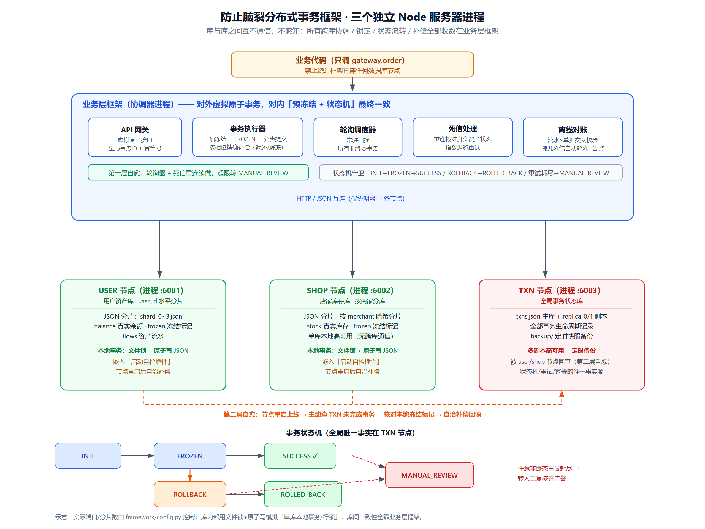
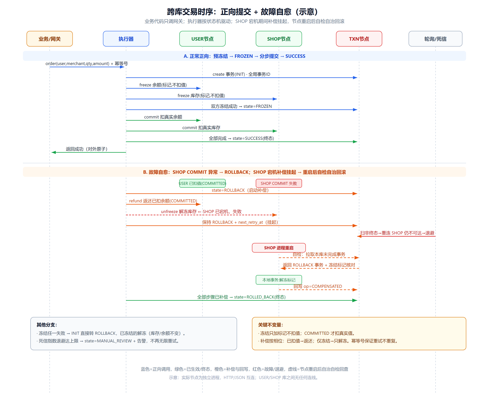

# Learn Distributed Transactions — Anti-Brain-Split Freeze Framework

> **Learning / study repo.** This is a hands-on learning project to understand how
> distributed transactions can be coordinated **without cross-database voting**, so
> that database-level split-brain is structurally impossible. It uses JSON files and
> three independent node processes to simulate real databases — not production code.

All cross-database coordination, locking, state transitions and compensation are
concentrated in a **business-layer framework**. Databases are fully independent,
never talk to each other, and only guarantee single-node local consistency. From the
outside this looks like an atomic transaction; inside it reaches eventual consistency
via **pre-freeze + a state machine**.





---

## 1. Architecture

```
                        ┌──────────────────────────────────────────────┐
  Business code (gateway)│        Business-layer framework (coordinator)  │
 ───────────────────────►│  gateway(virtual atomic) → executor(state m.)│
                        │  poller → deadletter(backoff retry)            │
                        │  offline_reconcile                              │
                        └──────────────┬──────────────┬──────────────┘
                          HTTP/JSON    │              │
              ┌───────────▼──────┐  ┌──▼─────────┐  ┌─▼──────────────┐
              │ user node (proc)│  │ shop node   │  │ txn node (proc) │
              │ user asset DB    │  │ inventory   │  │ global txn DB   │
              │ hash-sharded JSON│  │ per-merchant│  │ replicas+snap   │
              │ freeze markers   │  │ freeze mark │  │ txn lifecycle   │
              │ self-check plugin│  │ self-check  │  │                 │
              └─────────────────┘  └────────────┘  └─────────────────┘
```

- **Hard constraints**: no asset change may bypass the framework and write a node directly;
  assets support freeze markers (a local transaction marker that does not deduct the real
  value, with a TTL); every operation carries a global transaction ID + idempotency key.
- **Between databases**: they are completely unaware of each other — no communication,
  no shared consensus.

---

## 2. Modules

| Module | Code | Role |
|---|---|---|
| Transaction state store | `framework/node/logic.py` (`TxnNodeLogic`) | global txn records, replicas + snapshot backups |
| State machine | `framework/core/state_machine.py` | state transition rules + illegal-transition guard |
| Transaction executor | `framework/core/executor.py` | cross-node orchestration, idempotency, pre-freeze/commit/compensation |
| Poller | `framework/scheduler/poller.py` | scans all non-terminal transactions |
| Dead-letter handler | `framework/scheduler/deadletter.py` | reconnect, verify real state, exponential backoff, escalate to MANUAL_REVIEW |
| Node self-check plugin | `framework/node/self_check.py` | embedded in user/shop nodes, queries global txn center on startup and self-heals |
| Offline reconciler | `framework/reconcile/offline_reconcile.py` | cross-checks flows vs records, auto-unfreezes orphan freezes and alerts |
| API gateway | `framework/gateway.py` | business entry point, virtual atomic ops, no direct node access |

Node process entry: `node_entry.py`. One-click runner: `run_all.py`.

---

## 3. How to run

```bash
# One-click: spawn user/shop/txn three processes, run 7 demo cases, shut down
python run_all.py

# Or start the three nodes manually, then drive the framework yourself
python node_entry.py txn  6003 data/txn
set TXN_NODE_URL=http://127.0.0.1:6003   # user/shop nodes need txn center for self-check
python node_entry.py user 6001 data/user
python node_entry.py shop 6002 data/shop
```

Pure Python standard library, no third-party dependencies. After running, `data/`
contains the JSON shards, the txn main store, replicas and snapshot backups.

---

## 4. State machine

```
INIT           transaction created, trying to freeze
FROZEN         both sides frozen, ready to commit real values
ROLLBACK       compensation required
ROLLED_BACK    compensation done (terminal)
SUCCESS        all forward ops done (terminal)
MANUAL_REVIEW  retries exhausted, waiting for human review (terminal)
```

Allowed transitions (illegal ones are rejected by `state_machine.validate_transition`):

```
INIT      -> FROZEN | ROLLBACK | MANUAL_REVIEW
FROZEN    -> SUCCESS | ROLLBACK | MANUAL_REVIEW
ROLLBACK  -> ROLLED_BACK | MANUAL_REVIEW
any non-terminal -> MANUAL_REVIEW (retries exhausted)
```

Each operation has a **phase** (`PENDING → FROZEN → COMMITTED → COMPENSATED`) that
decides the compensation action:
- already deducted (COMMITTED) → **refund**;
- only frozen (FROZEN) → **unfreeze** (real value untouched).

---

## 5. Forward flow and compensation

**Forward**: create INIT → parallel local-transaction freezes (user balance, shop stock,
markers only) → all success moves to FROZEN → step-by-step real deductions → all
success moves to SUCCESS. Any freeze failure goes straight to ROLLBACK.

**Compensation**: any step failing / timing out / disconnecting → ROLLBACK → per-node
refund/unfreeze by phase → all done moves to ROLLED_BACK. If a node is unreachable in
the middle, the transaction stays pending and is resumed by the dead-letter handler or
the node self-check plugin.

---

## 6. Two layers of self-healing + fallback

1. **Layer 1: poller + dead-letter** — continuously scans non-terminal txns; downstream
   failures go to a dead-letter queue; consumption **reconnects and verifies the real
   asset state first**, then decides whether to continue forward or compensate, with
   **exponential backoff**; after max attempts it stops retrying and escalates to
   `MANUAL_REVIEW` with an alert.
2. **Layer 2: node startup self-check (self-healing rollback)** — while a node is down,
   the business layer cannot push compensation to it. When the node restarts it actively
   queries the global txn center, checks its local freeze markers, and (if the txn is
   ROLLBACK or the freeze TTL expired) performs local unfreeze/refund in its own local
   transaction, then writes back the global state.
3. **Fallback: offline reconciliation + snapshots** — periodically cross-checks user/shop
   flows against global records; **orphan freezes** (a marker with no global record) are
   auto-unfrozen and alerted; the global txn DB is snapshotted regularly to prevent record loss.

---

## 7. Boundaries

1. If both user DB and shop DB are completely down, the freeze phase cannot succeed at
   all, so no FROZEN transaction is ever created — no half-completed orders.
2. The only extreme risk: global txn DB is destroyed without a valid backup → orphan
   freezes appear, detected and alerted by the offline reconciler.
3. Each DB only guarantees single-node local consistency; cross-DB consistency is
   entirely the responsibility of the business-layer framework.

---

## 8. Demo cases (run by `run_all.py`)

| # | Case | Mechanism covered | Result |
|---|---|---|---|
| 1 | Normal order (deduct balance + stock) | forward flow + idempotent replay | INIT→FROZEN→SUCCESS |
| 2 | Freeze fails (insufficient balance) | freeze-phase rollback | shop freeze → unfreeze, stock unchanged |
| 3 | Shop COMMIT rejected | commit-phase rollback + refund deducted balance | ROLLED_BACK |
| 4 | Shop shard isolated → recovered | poller + dead-letter resume | SUCCESS |
| 5 | Shop process down → restart | node startup self-check rollback | ROLLED_BACK |
| 6 | Orphan freeze + global DB loss | offline reconcile auto-unfreeze + snapshot restore | cleanup + alert |
| 7 | Shop continuously unreachable | retries exhausted → MANUAL_REVIEW + alert | manual review |

The run prints every state transition, final state, balance/stock assertions and alerts.

---

## 9. Notes

- A node's "single-node local transaction" = file lock + read-modify-write JSON +
  atomic temp-file replace (`framework/node/json_store.py`).
- Sharding: users are hashed by `user_id`; shops are sharded by `merchant_id`; the txn
  state DB is replicated + snapshotted.
- Demo injection endpoints: `/admin/outage` (simulate shard down/up),
  `/admin/fail_commit` (simulate downstream failure at commit),
  `/admin/restart_selfcheck` (manually trigger self-check).
- Retry/timeout knobs live in `framework/config.py`: `BASE_BACKOFF / MAX_ATTEMPTS / FREEZE_TTL`.

> This repository is for learning and experimentation. For production you would replace
> the JSON stores with a real database, add poller leader election, a real MQ for the
> dead-letter queue, and duplicate-detection for self-check vs. poller.
